# OneStop UI Redesign — Before & After Showcase

**Branch:** `v4`  
**Stack:** Next.js 15 (App Router) · Tailwind CSS · Geist / Geist Mono / Instrument Serif · Chrome Extension (MV3)

---

## Summary of Changes

- **Design System:** Warm monochrome palette (`#FAF9F6` / `#FFFFFF` / `#F3F1EC` light, `#121210` / `#1A1A17` / `#22211E` dark) with a single forest-green accent (`#0F5C47` light, `#4FB08C` dark), `1px` borders instead of drop shadows, `8px`/`12px` radii, and Indian number formatting (`₹1,50,900`) in tabular `Geist Mono`.
- **Navigation & Card Wallet:** Minimal navbar (`OneStop`, `Home`, `Vault`, `My cards`, theme toggle). Card wallet moved out of page content into a persistent slide-over sheet (`My cards`).
- **Home (`/`):** `Instrument Serif` headline, single URL check input, and compact recent products list.
- **Product (`/product/[id]`):** Verdict card first (*Buy now / Wait / Fair price* + best price), unified sorted store comparison table (with inline streaming skeletons and mobile stacked rows), single-line Recharts price history (`30d / 90d / All`), *"Your best way to pay"* (*Pay today* vs *Rewards later*), and 4 collapsed accordions (*Offers & card breakdown*, *Seller trust*, *Exchange value*, *Warranty*).
- **Warranty Vault (`/vault`):** Two-step layout with an *"Add invoice"* PDF upload dialog and warranty countdown list.
- **Chrome Extension (`extension/`):** Matching light/dark tokens in `popup.html` and `content_script.js` Shadow DOM drawer, focused on *Verdict*, *Price today*, *Best price*, and *"Compare across stores"*.

---

## Verification

- `npx tsc --noEmit` — **0 errors**
- `npm run build` — **Passed**
- Playwright check across `/`, `/product/[id]`, `/vault` (desktop `1440×900` & mobile `375×812`, light & dark) — **Zero console or page errors**

---

## 1. Home (`/`)

### Before (Light)
| Desktop (`1440×900`) | Mobile (`375×812`) |
| :---: | :---: |
| 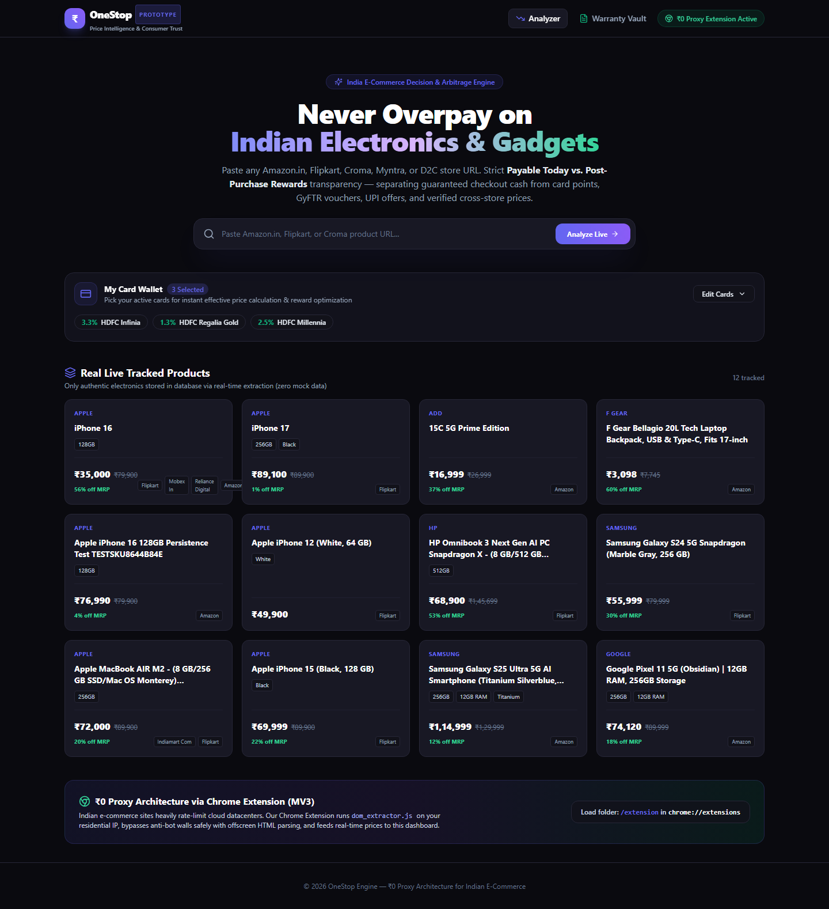 | 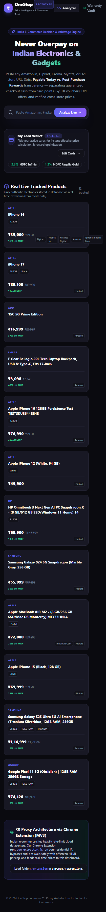 |

### After — Light
| Desktop (`1440×900`) | Mobile (`375×812`) |
| :---: | :---: |
| 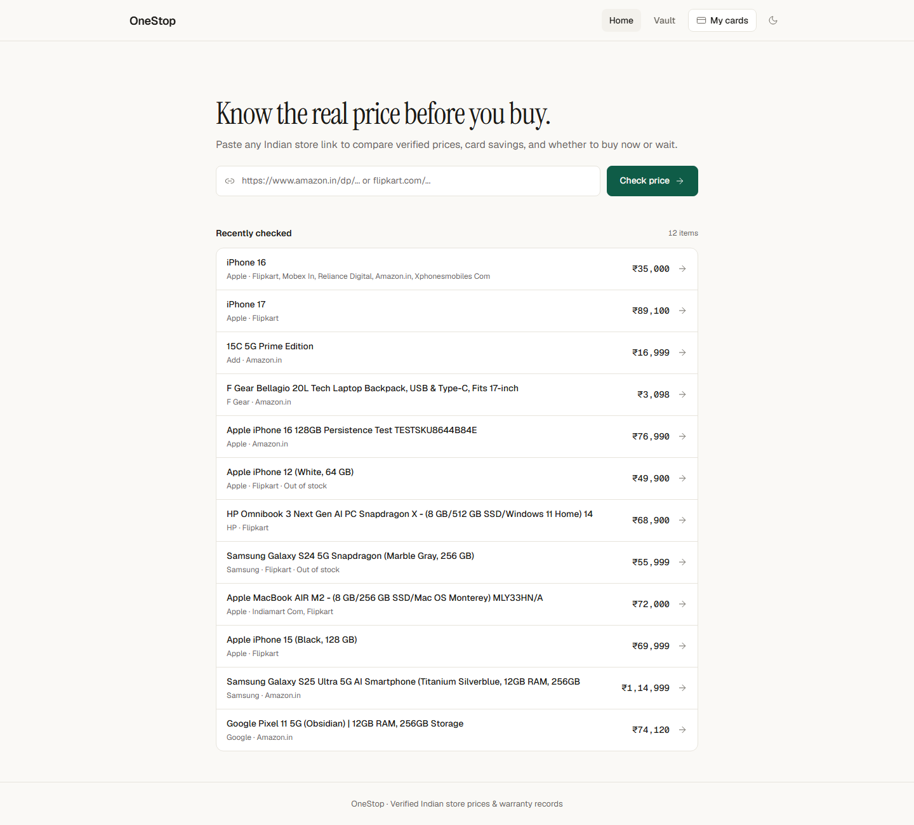 | 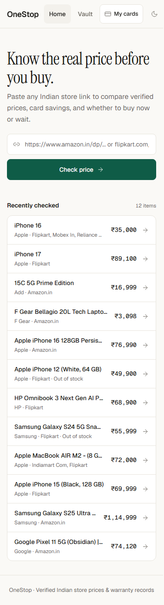 |

### After — Dark
| Desktop (`1440×900`) | Mobile (`375×812`) |
| :---: | :---: |
| 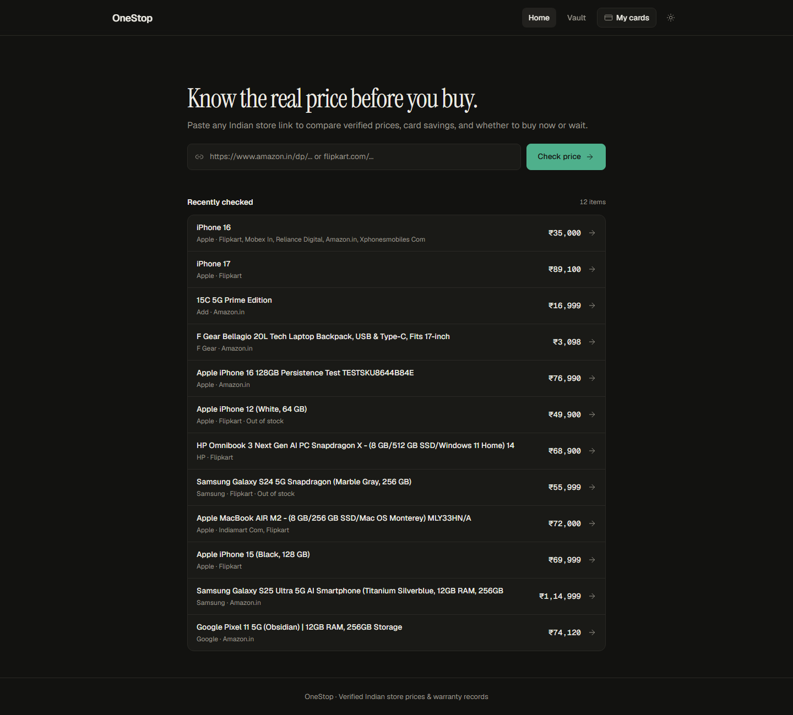 | 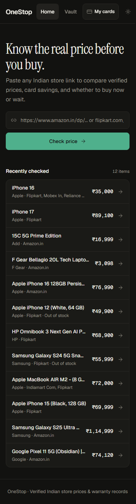 |

---

## 2. Product Decision Page (`/product/[id]`)

### Before (Light)
| Desktop (`1440×900`) | Mobile (`375×812`) |
| :---: | :---: |
| 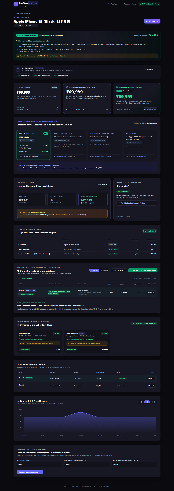 | 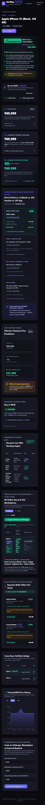 |

### After — Light
| Desktop (`1440×900`) | Mobile (`375×812`) |
| :---: | :---: |
| 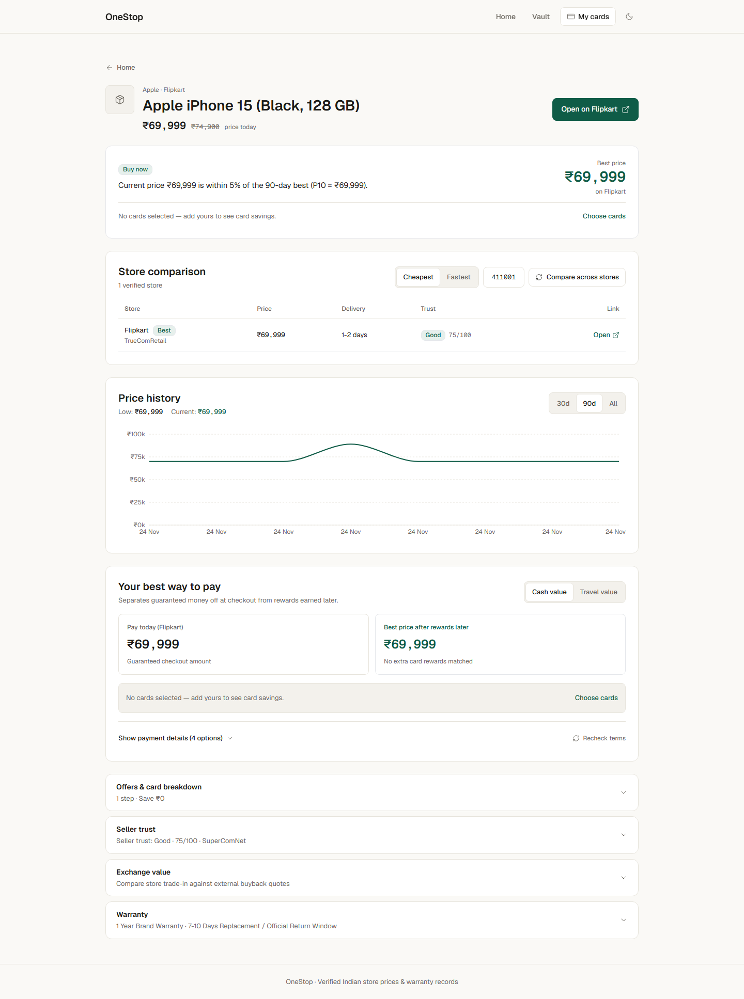 | 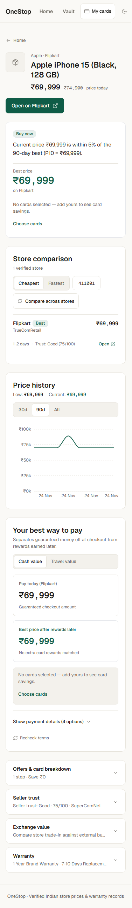 |

### After — Dark
| Desktop (`1440×900`) | Mobile (`375×812`) |
| :---: | :---: |
| 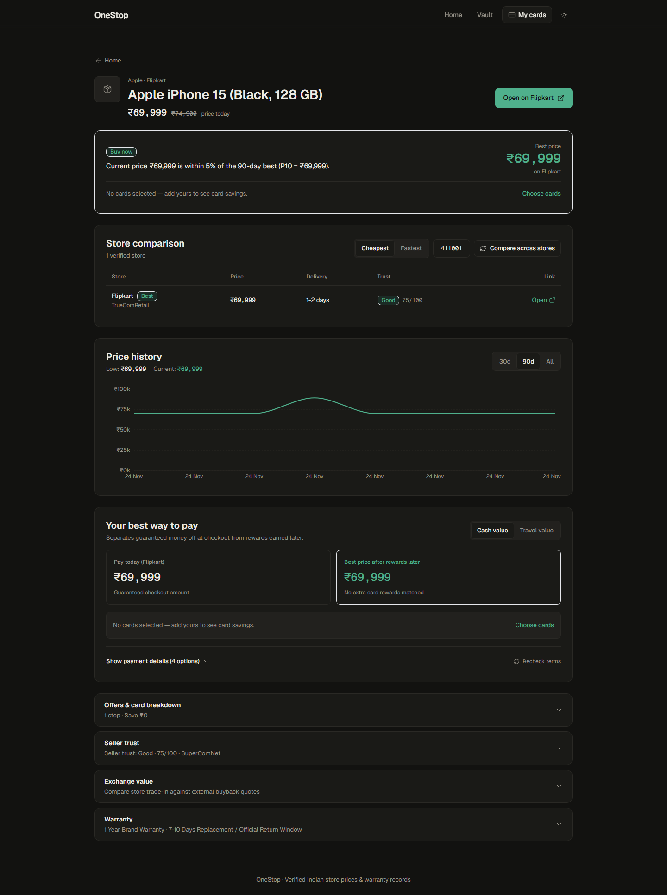 | 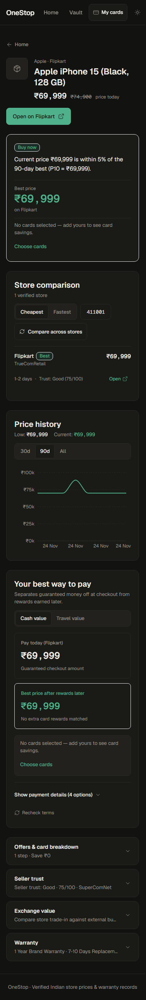 |

---

## 3. Warranty Vault (`/vault`)

### Before (Light)
| Desktop (`1440×900`) | Mobile (`375×812`) |
| :---: | :---: |
| 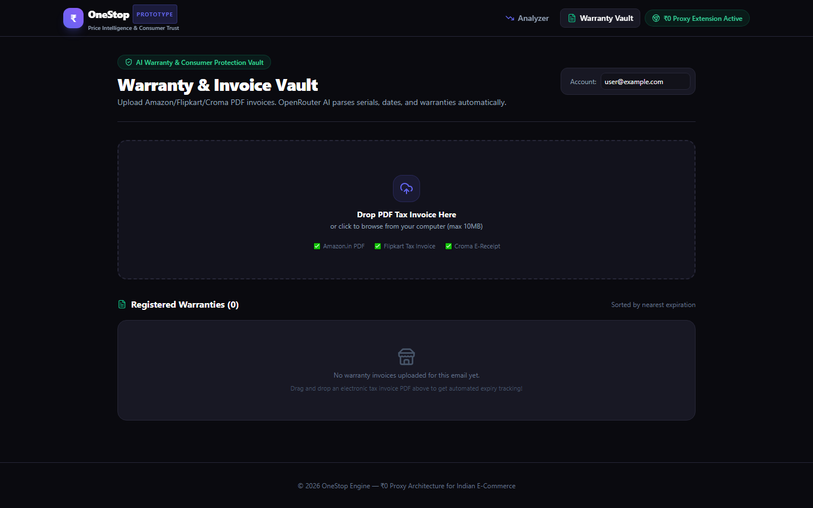 | 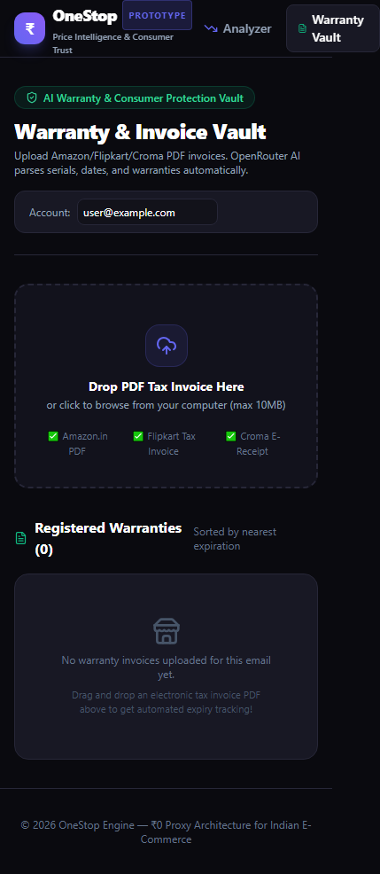 |

### After — Light
| Desktop (`1440×900`) | Mobile (`375×812`) |
| :---: | :---: |
| 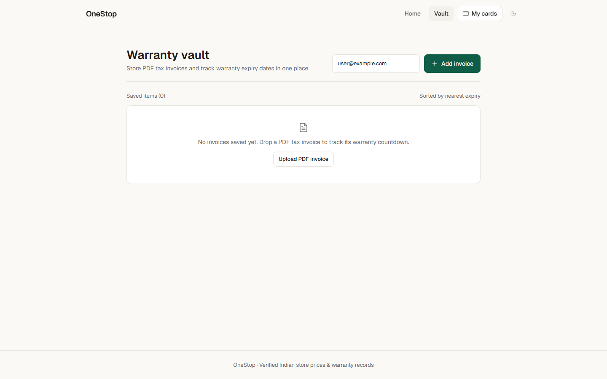 | 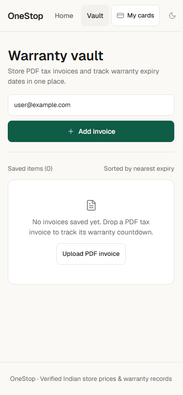 |

### After — Dark
| Desktop (`1440×900`) | Mobile (`375×812`) |
| :---: | :---: |
| 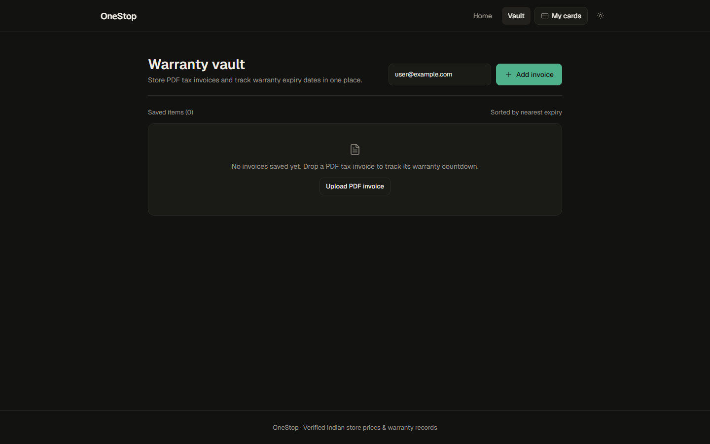 | 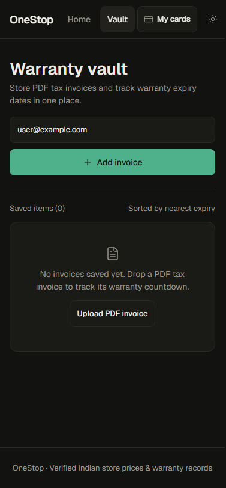 |
